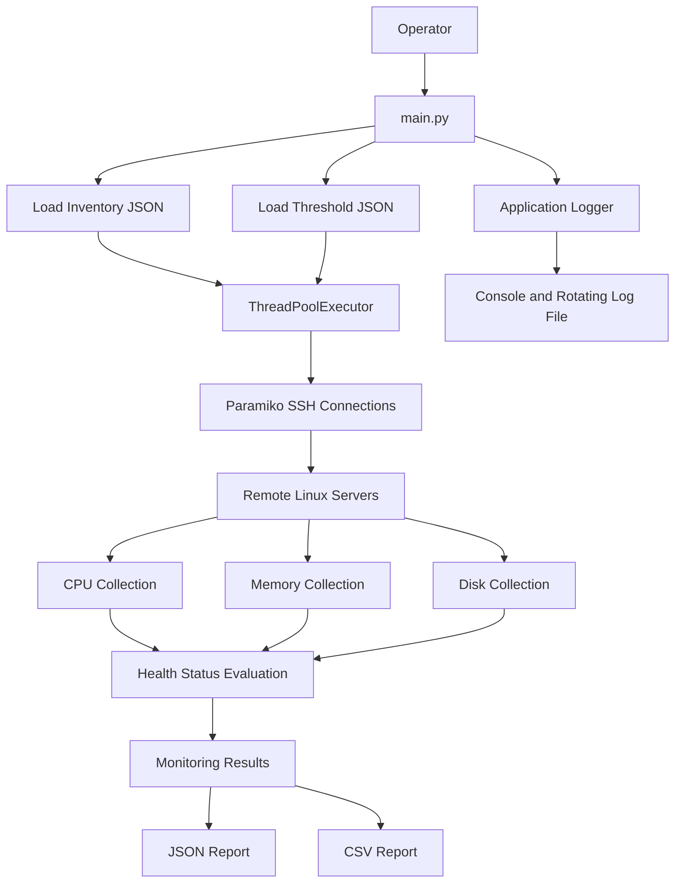

# Remote Linux Health Collector

A Python-based DevOps automation project that monitors the health of multiple remote Linux servers over SSH using Paramiko.

The application collects CPU, memory and disk utilization, evaluates resource usage against configurable thresholds, and generates timestamped JSON and CSV health reports.

It supports concurrent monitoring of multiple servers, structured logging, SSH failure handling and automated report generation.

## 1. Project Overview

### Objectives

- Monitor multiple remote Linux servers from a single machine.
- Establish secure SSH connections using Paramiko.
- Collect CPU, memory and disk utilization.
- Evaluate server health using configurable warning and critical thresholds.
- Execute monitoring tasks concurrently.
- Handle SSH authentication, connectivity and monitoring failures.
- Generate JSON and CSV reports.
- Maintain application logs with automatic log rotation.

### Technologies

| Technology | Purpose |
|---|---|
| Python 3.12 | Application development |
| Paramiko | SSH connectivity |
| Linux | Remote server operating system |
| ThreadPoolExecutor | Concurrent execution |
| JSON | Configuration and reporting |
| CSV | Health report export |
| Pytest | Unit and failure-handling tests |
| Ruff | Linting and formatting |
| Git and GitHub | Version control |

## 2. Architecture



### Execution workflow

1. The application starts through `main.py`.
2. It initializes the application logger.
3. It loads the server inventory and threshold configuration.
4. It validates that the inventory contains at least one server.
5. It creates a ThreadPoolExecutor with a maximum of five workers.
6. Each worker establishes an SSH connection using Paramiko.
7. CPU, memory and disk metrics are collected.
8. Resource utilization is evaluated against configured thresholds.
9. Results and errors are collected for each server.
10. JSON and CSV reports are generated.
11. A monitoring summary is displayed.

## 3. Repository Structure

```text
python-remote-linux-health-collector/
│
├── config/
│   ├── inventory.example.json
│   └── thresholds.json
│
├── logs/
│   └── .gitkeep
│
├── reports/
│   └── .gitkeep
│
├── src/
│   ├── __init__.py
│   ├── logger_config.py
│   ├── report_generator.py
│   ├── ssh_connection.py
│   └── system_metrics.py
│
├── tests/
│   ├── test_connection_failures.py
│   ├── test_main.py
│   ├── test_report_generator.py
│   └── test_system_metrics.py
│
├── .gitignore
├── main.py
├── requirements.txt
└── README.md
```

## 4. Prerequisites

- Python 3.12
- Linux or WSL Ubuntu environment
- Git
- SSH access to remote Linux servers
- SSH private key for authentication
- Python virtual environment

## 5. Installation

Clone the repository:

```bash
git clone https://github.com/Jadagoud/python-remote-linux-health-collector.git
```

Navigate to the project:

```bash
cd python-remote-linux-health-collector
```

Create a virtual environment:

```bash
python3 -m venv .venv
```

Activate the virtual environment:

```bash
source .venv/bin/activate
```

Upgrade pip:

```bash
python -m pip install --upgrade pip
```

Install dependencies:

```bash
pip install -r requirements.txt
```

## 6. SSH Inventory Configuration

The application reads server information from:

```text
config/inventory.json
```

Create your local inventory:

```bash
cp config/inventory.example.json config/inventory.json
```

Example configuration:

```json
{
  "servers": [
    {
      "name": "example-server-01",
      "host": "203.0.113.10",
      "username": "ubuntu",
      "key_file": "/home/your-user/.ssh/example.pem"
    }
  ]
}
```

### Configuration fields

| Field | Description |
|---|---|
| name | Logical server name |
| host | Remote server IP or hostname |
| username | SSH username |
| key_file | Path to SSH private key |

Update these values for your environment.

### SSH security

- Keep private keys outside the project directory.
- Set restrictive permissions on private keys.
- Use an appropriate least-privilege SSH account.
- Ensure remote host keys are trusted in `known_hosts`.
- The application uses host-key verification and rejects unknown host keys.
- Never commit the real inventory or private keys.

## 7. Health Threshold Configuration

The application reads thresholds from:

```text
config/thresholds.json
```

Current configuration:

```json
{
  "cpu": {
    "warning": 70,
    "critical": 90
  },
  "memory": {
    "warning": 75,
    "critical": 90
  },
  "disk": {
    "warning": 80,
    "critical": 90
  }
}
```

### Threshold explanation

| Resource | Warning | Critical |
|---|---:|---:|
| CPU | 70% | 90% |
| Memory | 75% | 90% |
| Disk | 80% | 90% |

### Health evaluation logic

The application uses the following logic:

```python
def get_health_status(value, warning, critical):

    if value >= critical:
        return "CRITICAL"

    if value >= warning:
        return "WARNING"

    return "HEALTHY"
```

Example:

| Utilization | Status |
|---:|---|
| 50% | HEALTHY |
| 70% | WARNING |
| 85% | WARNING |
| 90% | CRITICAL |
| 95% | CRITICAL |

The critical threshold is checked first.

## 8. System Metrics Collection

### CPU utilization

CPU metrics are collected using Linux `/proc/stat`.

The application samples CPU counters over a one-second interval and calculates utilization using the difference between the two samples.

### Memory utilization

Memory information is collected using:

```bash
free -b
```

The application uses total memory and available memory to calculate utilization.

### Disk utilization

Disk information is collected using:

```bash
df -P /
```

The application monitors root filesystem utilization.

## 9. Concurrent Server Monitoring

The application uses Python's `ThreadPoolExecutor`.

```python
max_workers = min(5, len(servers))
```

This means:

- One server: one worker.
- Three servers: three workers.
- Five servers: five workers.
- More than five servers: maximum five workers at a time.

Each server is monitored independently.

The application uses `as_completed()` to process results as individual monitoring tasks finish.

## 10. Running the Application

Ensure that the inventory and threshold files are configured.

Run:

```bash
python main.py
```

The application displays:

- Number of servers being monitored.
- Number of parallel workers.
- Individual server monitoring results.
- CPU, memory and disk utilization.
- Health status.
- Monitoring summary.
- Generated report locations.

## 11. Error Handling

The application handles several SSH and monitoring failure scenarios.

| Failure | Application status |
|---|---|
| SSH authentication failure | AUTHENTICATION_FAILED |
| Unknown or mismatched host key | HOST_KEY_VERIFICATION_FAILED |
| Server unreachable | UNREACHABLE |
| SSH protocol or connection failure | CONNECTION_FAILED |
| Metric collection failure | MONITORING_FAILED |
| Successful collection | SUCCESS |

The SSH client is closed in a `finally` block to ensure connection cleanup, including when failures occur.

## 12. Reports

Reports are generated inside:

```text
reports/
```

The application generates two timestamped files for each execution.

### JSON report

Contains:

- Report generation timestamp in UTC.
- Total number of servers.
- Successful monitoring count.
- Failed monitoring count.
- Individual server monitoring results.

### CSV report

Contains:

- Server name.
- Hostname.
- Monitoring status.
- CPU usage and status.
- Memory usage and status.
- Disk usage and status.
- Error information.

JSON is useful for programmatic processing, while CSV is convenient for spreadsheet analysis.

## 13. Application Logging

The application uses Python's logging module and `RotatingFileHandler`.

Log file:

```text
logs/health_collector.log
```

Configuration:

| Setting | Value |
|---|---|
| Log level | INFO |
| Maximum file size | 5 MB |
| Backup files | 5 |
| Output | Console and log file |

Log rotation helps prevent the log file from growing indefinitely.

## 14. Running Tests

The project uses Pytest.

Run all tests:

```bash
pytest -v
```

The test suite covers:

- Health threshold evaluation.
- CPU, memory and disk metric parsing.
- JSON and CSV report generation.
- SSH authentication failures.
- Connection timeouts.
- SSH connection failures.
- Metric collection failures.
- SSH client cleanup.

## 15. Code Quality

Run Ruff linting:

```bash
ruff check .
```

Format Python files:

```bash
ruff format .
```

Verify formatting:

```bash
ruff format --check .
```

## 16. Troubleshooting

### Authentication failure

Check:

- SSH username.
- Private key path.
- Private key permissions.
- Public key authorization on the remote server.

### Server unreachable

Check:

- EC2 instance state.
- Public IP or DNS name.
- Security group inbound rules.
- Network connectivity.
- SSH port 22.

### Host key verification failure

Verify the remote server's host key fingerprint and update the trusted `known_hosts` entry only after confirming its authenticity.

### Inventory configuration error

Check that:

- `config/inventory.json` exists.
- JSON syntax is valid.
- The `servers` list is not empty.
- Required server fields are present.

### Report generation failure

Check write permissions for the `reports/` directory.

## 17. Security Best Practices

- Never commit private keys.
- Never commit real server inventory containing sensitive infrastructure details.
- Keep secrets outside the Git repository.
- Use SSH host-key verification.
- Restrict EC2 SSH access to trusted source IP addresses.
- Follow least-privilege access principles.
- Review reports and logs before sharing them publicly.

## 18. Interview Talking Points

Be prepared to explain:

1. Why Paramiko was selected for remote SSH automation.
2. How SSH authentication works using private keys.
3. How SSH host-key verification protects against unknown hosts.
4. How `/proc/stat` is used to calculate CPU utilization.
5. Why `MemAvailable` is used when calculating memory utilization.
6. How Linux `df` provides disk utilization.
7. Why ThreadPoolExecutor is suitable for concurrent SSH operations.
8. How the application handles unreachable servers.
9. Why a `finally` block is used for SSH cleanup.
10. How configurable thresholds support monitoring.
11. Why JSON and CSV reports are both generated.
12. How rotating logs help with troubleshooting.
13. How unit tests validate failure scenarios.
14. How the project could be extended with Prometheus, Grafana, alerting and scheduled monitoring.

## 19. Future Enhancements

Potential improvements include:

- Email and Slack alerting.
- Prometheus metrics integration.
- Grafana dashboards.
- Historical health tracking.
- Additional filesystem monitoring.
- Configurable SSH connection timeouts.
- Input schema validation.
- CI/CD pipeline using GitHub Actions.
- Scheduled monitoring using cron or systemd.

## 20. Repository

GitHub:

https://github.com/Jadagoud/python-remote-linux-health-collector

---

**Project:** Remote Linux Health Collector
**Category:** Python DevOps Automation
**Primary purpose:** Automated remote Linux server health monitoring.
